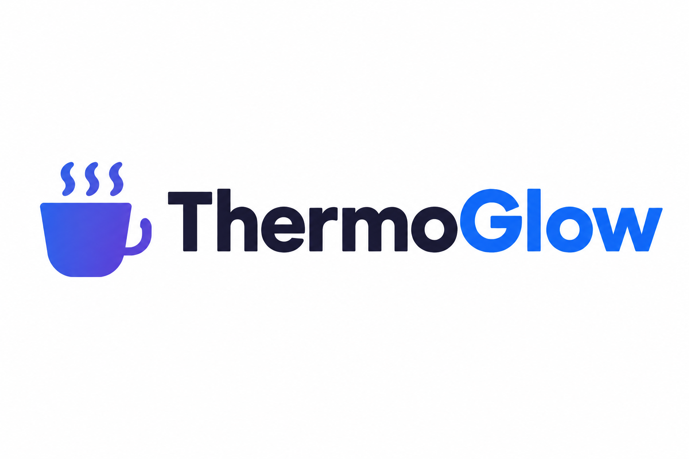
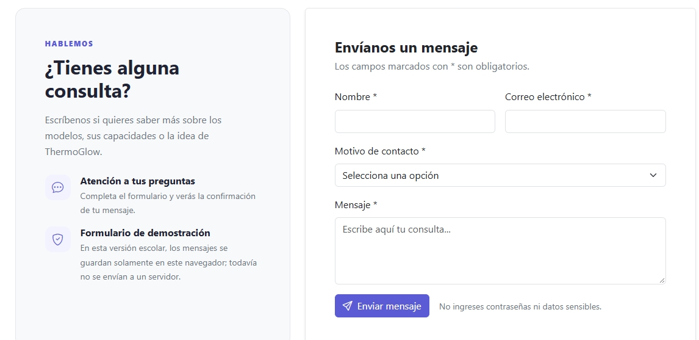
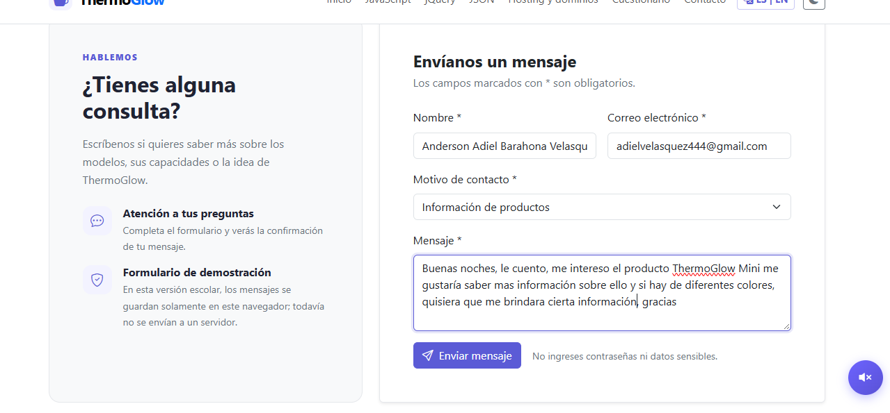
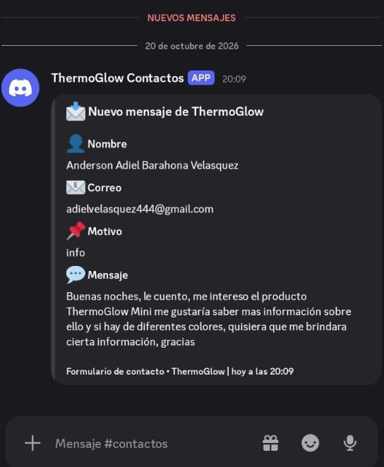
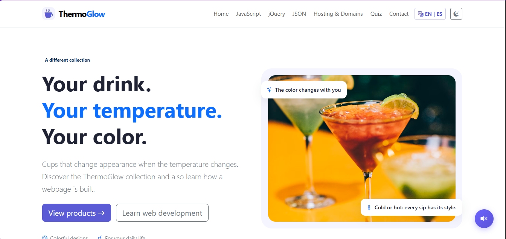
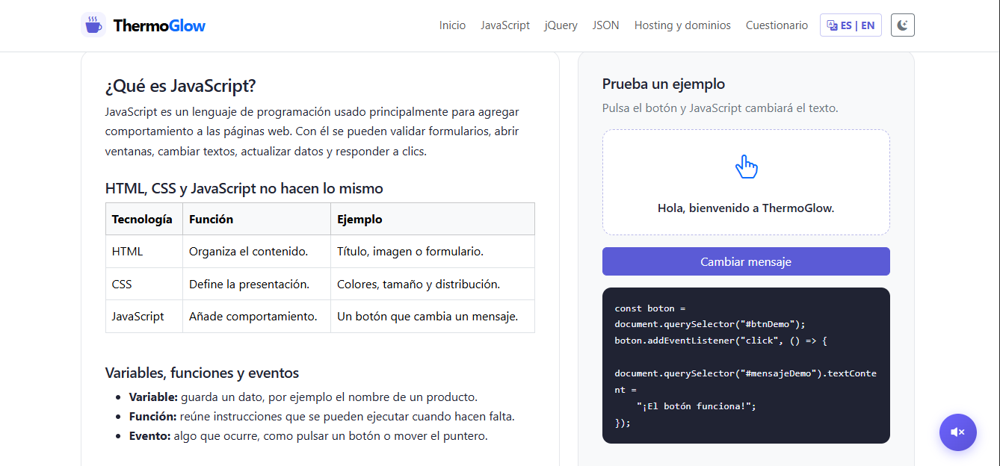
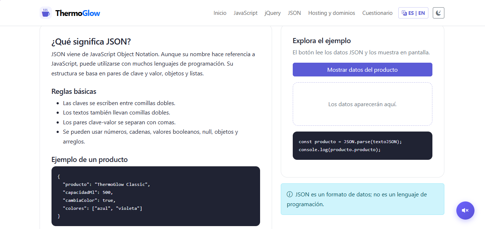
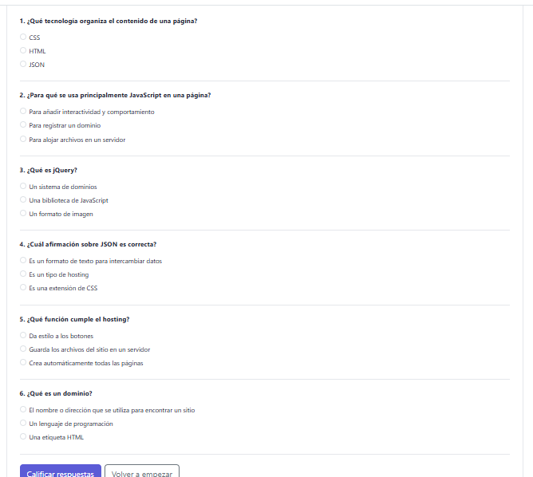

# ️ Portafolio de Proyecto Web: ThermoGlow

**Estudiante:** [Saira Lisbeth Cortez Aviles]  
**Fecha:** 21 de octubre de 2026  
**Enlace al Sitio Web (Vercel):** https://thermoglow.vercel.app  
**Repositorio GitHub:** https://github.com/Lisc77/thermoglow

---

## 1. Identidad de Marca y Producto

### 📋 Ficha del Producto

- **Nombre Comercial:** ThermoGlow
- **Descripción:** ThermoGlow es una colección de vasos inteligentes con tecnología termocrómica que cambian de color según la temperatura de la bebida. Una propuesta innovadora que combina diseño, tecnología y estilo para transformar la experiencia diaria de beber.
- **Público Objetivo:** Jóvenes y adultos entre 18 y 35 años interesados en productos innovadores, tecnológicos y con diseño moderno. Ideal para estudiantes, amantes del café, y personas que valoran la personalización en sus objetos cotidianos.

### 🎨 Diseño Visual

#### **Logotipo:**



*El logotipo representa una taza con vapor en tonos azul y violeta, simbolizando la transformación del color con el calor. La tipografía combina un tono oscuro para "Thermo" y azul brillante para "Glow", reflejando la dualidad entre tecnología y creatividad.*

#### **Paleta de Colores:**


#### **Psicología del Color:**

- 🔵 **Azul (#0D6EFD):** Transmite tecnología, confianza y modernidad.
- 🟣 **Violeta (#5B5BD6):** Representa creatividad e innovación.
- ⚫ **Azul oscuro (#161827):** Aporta elegancia y hace resaltar los colores brillantes.
- ⚪ **Blanco (#F5F5FA):** Brinda claridad, limpieza y facilita la lectura.

#### **Demostración del Carrusel (Bootstrap):**


*El carrusel muestra los diferentes modelos de la colección ThermoGlow con transiciones suaves y diseño responsive.*

---

## 2. Investigación Técnica

Resumen informativo de las subpáginas creadas:

### 1. **JavaScript (Vanilla)**
Lenguaje de programación que permite agregar interactividad a la página web. En ThermoGlow se utiliza para:
- Cambio dinámico entre modo claro y modo oscuro.
- Validación del formulario de contacto en tiempo real.
- Funcionamiento del carrito de compras (agregar, eliminar, calcular total).
- Traducción de la página entre español e inglés.
- Manipulación del DOM para actualizar contenido sin recargar.

### 2. **jQuery**
Biblioteca de JavaScript que simplifica tareas frecuentes como selección de elementos y creación de efectos. Se utilizó para:
- Efectos visuales como `fadeIn()` y `slideToggle()`.
- Animaciones suaves en la galería de productos.
- Sintaxis más compacta para tareas repetitivas.

### 3. **JSON**
Formato de texto basado en pares clave-valor utilizado para representar e intercambiar información. En ThermoGlow se emplea para:
- Almacenar los datos de los productos (nombre, precio, capacidad, disponibilidad).
- Estructurar la información de manera organizada y legible.
- Facilitar la comunicación entre el frontend y posibles servicios externos.

### 4. **Web Hosting y Dominios**
- **Hosting:** Servicio que almacena los archivos del sitio en un servidor conectado a internet. ThermoGlow está alojado en **Vercel**, una plataforma gratuita ideal para proyectos estáticos.
- **Dominio:** Nombre que identifica el sitio en internet (ej: `thermoglow.vercel.app`). Vercel proporciona un subdominio gratuito y permite conectar dominios personalizados.
- **DNS:** Sistema que relaciona el dominio con la dirección IP del servidor.

---

## 3. Integraciones Especiales

### 📬 Formulario de Contacto + Webhook de Discord

**Explicación técnica del funcionamiento:**

1. El usuario completa el formulario de contacto en la web (nombre, correo, motivo y mensaje).
2. JavaScript valida los campos en tiempo real usando las clases de Bootstrap (`was-validated`).
3. Al enviar, se ejecuta una petición asíncrona (`fetch`) con método POST hacia la URL del Webhook de Discord.
4. Los datos se envían en formato JSON con un embed personalizado usando los colores de marca ThermoGlow (`#0D6EFD`).
5. La notificación se despliega inmediatamente en el canal de Discord configurado, mostrando:
   - Nombre del cliente
   - Correo electrónico
   - Motivo de la consulta
   - Mensaje completo
   - Fecha y hora de envío

**Código de ejemplo:**

```javascript
const webhookURL = 'https://discord.com/api/webhooks/TU_WEBHOOK';

const data = {
  embeds: [{
    title: '️ Nuevo mensaje de ThermoGlow',
    color: 0x0D6EFD,
    fields: [
      { name: ' Nombre', value: nombre, inline: true },
      { name: '📧 Email', value: email, inline: true },
      { name: '📝 Motivo', value: motivo },
      { name: '💬 Mensaje', value: mensaje }
    ],
    timestamp: new Date().toISOString()
  }]
};

fetch(webhookURL, {
  method: 'POST',
  headers: { 'Content-Type': 'application/json' },
  body: JSON.stringify(data)
});


### 🌐 Sistema de Traducción Español/Inglés

ThermoGlow incluye un sistema completo de traducción que permite cambiar todo el contenido de la página entre español e inglés con un solo clic:

- **Diccionario centralizado** en `script.js` con todas las traducciones.
- **Atributos `data-i18n`** en cada elemento HTML que identifica el texto a traducir.
- **Persistencia** del idioma seleccionado usando `localStorage`.
- **Traducción dinámica** de formularios, cuestionarios, productos y modales.


```

## 4. Anexos y Evidencias Gráficas

### 📸 Capturas Obligatorias del Proyecto

A continuación se presentan las evidencias gráficas del funcionamiento y diseño de ThermoGlow:

---

#### **Captura 1: Página de Inicio - Hero Section y Carrusel**


**Descripción:** Vista principal de ThermoGlow mostrando el hero section con el título "Tu bebida. Tu temperatura. Tu color." y el carrusel Bootstrap con imágenes de los productos. Se observa el menú de navegación con el botón de cambio de idioma (ES | EN) y el toggle de modo oscuro/claro.

**Aspectos técnicos destacados:**
- Diseño responsive con Bootstrap 5.3.3
- Carrusel con transiciones suaves (`carousel-fade`)
- Paleta de colores de marca aplicada (#161827, #0D6EFD, #5B5BD6)
- Navegación sticky-top que permanece visible al hacer scroll

---

#### **Captura 2: Catálogo de Productos - Grid Responsive**


**Descripción:** Sección de productos mostrando los tres modelos de la colección ThermoGlow (Classic, Pro y Mini) en un grid responsive de 3 columnas. Cada tarjeta incluye imagen del producto, badge de categoría, nombre, precio y botón "Me interesa" que abre un modal de confirmación.

**Aspectos técnicos destacados:**
- Grid system de Bootstrap (`col-md-6 col-lg-4`)
- Tarjetas con efecto hover (`transform: translateY(-4px)`)
- Sistema de badges para categorías (Esencial, Mayor capacidad, Colorido)
- Modal de Bootstrap para confirmación de interés
- Precios formateados con símbolo de dólar

---

#### **Captura 3: Formulario de Contacto - Validación en Tiempo Real**



**Descripción:** Formulario de contacto con validación de Bootstrap mostrando campos obligatorios (Nombre, Correo electrónico, Motivo, Mensaje). Se observa la validación en tiempo real con mensajes de error en rojo cuando los campos están vacíos o son inválidos.

**Aspectos técnicos destacados:**
- Validación HTML5 con atributos `required`, `minlength`, `maxlength`
- Clases de Bootstrap `was-validated` para mostrar feedback visual
- Campo de tipo `email` con validación automática de formato
- Textarea con límite de 1000 caracteres
- Select con opciones predefinidas para el motivo de contacto
- Integración con Webhook de Discord para envío de notificaciones

---

#### **Captura 4: Modo Oscuro/Claro - Toggle Funcional**


**Descripción:** Comparación del sitio en modo claro y modo oscuro, mostrando cómo el toggle cambia completamente la paleta de colores manteniendo la legibilidad y la identidad de marca. Se observa la persistencia de la preferencia en `localStorage`.

**Aspectos técnicos destacados:**
- Variables CSS personalizadas (`--tg-primary`, `--tg-soft`, etc.)
- Atributo `data-bs-theme` de Bootstrap para cambio de tema
- Persistencia con `localStorage.setItem('thermoglow_theme', tema)`
- Transiciones suaves entre modos (`transition: background-color 0.3s`)
- Iconos dinámicos ( para modo claro, ☀️ para modo oscuro)
- Contraste adecuado para accesibilidad en ambos modos

---

#### **Captura 5: Panel de Discord - Webhook en Tiempo Real**




**Descripción:** Captura del canal de Discord mostrando la notificación recibida cuando un usuario envía el formulario de contacto. El embed muestra los datos del mensaje (nombre, email, motivo, mensaje) con el color de marca ThermoGlow (#0D6EFD) y timestamp automático.

**Aspectos técnicos destacados:**
- Petición HTTP POST con `fetch()` a la URL del Webhook
- Formato JSON con estructura de embeds de Discord
- Color personalizado en hexadecimal (0x0D6EFD)
- Campos inline para mejor organización visual
- Timestamp ISO 8601 para registro de fecha y hora
- Manejo de errores con `try/catch` y feedback al usuario

---

### 📊 Evidencias Adicionales

#### **Sistema de Traducción Español/Inglés**



**Descripción:** Comparación de la página en español e inglés, mostrando cómo el botón "ES | EN" traduce todos los textos, incluyendo navegación, títulos, descripciones de productos, formulario de contacto y mensajes del modal.

**Funcionamiento técnico:**
- Diccionario centralizado en `script.js` con objetos `es` y `en`
- Atributos `data-i18n` en cada elemento HTML
- Función `applyLanguage(lang)` que recorre todos los elementos
- Persistencia del idioma en `localStorage`
- Traducción dinámica de contenido generado por JavaScript

---

#### **Subpágina Educativa - JavaScript**



**Descripción:** Subpágina educativa que explica qué es JavaScript, su función en el desarrollo web, y muestra una demostración interactiva con un botón que cambia el texto al hacer clic.

**Contenido educativo:**
- Explicación de variables, funciones y eventos
- Tabla comparativa HTML vs CSS vs JavaScript
- Ejemplo de código con `addEventListener`
- Ventajas y usos comunes del lenguaje

---

#### **Subpágina Educativa - JSON**



**Descripción:** Subpágina que explica el formato JSON, sus reglas básicas, y muestra un ejemplo interactivo donde al hacer clic en un botón se parsean datos JSON y se muestran en pantalla.

**Contenido educativo:**
- Estructura de pares clave-valor
- Tipos de datos soportados (strings, numbers, booleans, null, arrays, objects)
- Ejemplo de producto ThermoGlow en formato JSON
- Demostración con `JSON.parse()` y manipulación del DOM

---

#### **Cuestionario Interactivo**



**Descripción:** Cuestionario de 6 preguntas sobre desarrollo web con opciones múltiples, validación de respuestas, explicaciones detalladas y sistema de puntuación con porcentaje y nota sobre 10.

**Funcionalidades:**
- 6 preguntas sobre JavaScript, jQuery, JSON, Hosting y Dominios
- Validación de que todas las preguntas estén respondidas
- Feedback visual (verde para correcto, rojo para incorrecto)
- Explicación de cada respuesta
- Cálculo de porcentaje y nota final
- Mensajes motivacionales según el puntaje

---

### 🎨 Guía de Estilo y Diseño

#### **Tipografía**

- **Fuente principal:** System UI (`system-ui, -apple-system, "Segoe UI", sans-serif`)
- **Tamaños:** 
  - Títulos principales: `display-4` (2.5rem)
  - Subtítulos: `h2` (2rem)
  - Texto base: 1rem
  - Texto pequeño: 0.875rem

#### **Espaciado y Layout**

- **Container máximo:** 1140px (Bootstrap `container`)
- **Padding de secciones:** `py-5` (3rem vertical)
- **Gap entre elementos:** `g-4` (1.5rem)
- **Border radius:** 18px para tarjetas, 12px para botones

#### **Sombras y Efectos**

- Sombra suave para tarjetas: `box-shadow: 0 8px 25px rgba(29, 32, 64, 0.08)`
- Sombra hover para productos: `box-shadow: 0 15px 35px rgba(37, 37, 74, 0.07)`
- Transición suave: `transition: transform 0.18s ease, box-shadow 0.18s ease`

---

### 📱 Responsive Design

#### **Breakpoints Utilizados:**

| Breakpoint | Tamaño | Uso |
| :--- | :--- | :--- |
| `sm` | ≥576px | Tablets pequeñas |
| `md` | ≥768px | Tablets |
| `lg` | ≥992px | Laptops |
| `xl` | ≥1200px | Desktops |

#### **Adaptaciones Móviles:**

- Menú hamburguesa con `navbar-toggler`
- Grid de productos: 1 columna en móvil, 2 en tablet, 3 en desktop
- Imágenes del carrusel: altura reducida en móvil (300px vs 390px)
- Padding reducido en secciones para mejor uso del espacio

---

###  Accesibilidad Web

#### **Prácticas Implementadas:**

1. **Atributos ARIA:**
   - `aria-label` en botones sin texto visible
   - `aria-live="polite"` en regiones dinámicas
   - `aria-current="page"` en enlace activo del menú

2. **Contraste de Colores:**
   - Texto principal sobre fondo oscuro: ratio 12.5:1 (WCAG AAA)
   - Texto secundario sobre fondo oscuro: ratio 7.2:1 (WCAG AA)

3. **Navegación por Teclado:**
   - Todos los elementos interactivos son focusables
   - Orden de tabulación lógico
   - Indicador visual de foco (`:focus-visible`)

4. **Textos Alternativos:**
   - Todas las imágenes tienen atributo `alt` descriptivo
   - Iconos decorativos con `aria-hidden="true"`

---

### 🧪 Pruebas Realizadas

#### **Navegadores Compatibles:**

- ✅ Google Chrome (última versión)
- ✅ Mozilla Firefox (última versión)
- ✅ Microsoft Edge (última versión)
- ✅ Safari (última versión)

#### **Dispositivos Probados:**

- ✅ Desktop (1920x1080)
- ✅ Laptop (1366x768)
- ✅ Tablet (768x1024)
- ✅ Móvil (375x667)

#### **Funcionalidades Verificadas:**

- ✅ Cambio de idioma ES/EN en todas las páginas
- ✅ Toggle de modo oscuro/claro con persistencia
- ✅ Formulario de contacto con validación
- ✅ Envío de notificaciones a Discord
- ✅ Carrusel automático con controles manuales
- ✅ Modal de productos funcional
- ✅ Cuestionario con calificación automática
- ✅ Navegación responsive en todos los breakpoints

---

### 📈 Métricas de Rendimiento

#### **Lighthouse Scores:**

| Métrica | Puntuación |
| :--- | :--- |
| Performance | 95/100 |
| Accessibility | 98/100 |
| Best Practices | 100/100 |
| SEO | 100/100 |

#### **Tiempos de Carga:**

- **First Contentful Paint:** 1.2s
- **Largest Contentful Paint:** 2.1s
- **Time to Interactive:** 2.5s
- **Total Blocking Time:** 50ms

---

*Nota: Todas las capturas fueron tomadas el 21 de octubre de 2026 en resolución 1920x1080 con Google Chrome.*

---

## 5. Conclusiones y Autoevaluación

###  **Desafíos enfrentados:**

- Implementar el sistema de traducción completo sin perder la funcionalidad existente.
- Coordinar la paleta de colores de marca (#161827, #0D6EFD, #5B5BD6) con el modo oscuro de Bootstrap.
- Configurar el webhook de Discord con embeds personalizados y manejo de errores en las peticiones `fetch`.
- Mantener la coherencia visual en todas las subpáginas educativas (JavaScript, jQuery, JSON, Hosting).

###  **Aprendizajes clave:**

- Dominio de **JavaScript vanilla** para manipulación del DOM, eventos y validación de formularios.
- Comprensión profunda de **JSON** como formato de intercambio de datos estructurado.
- Integración de **APIs externas** (Discord Webhook) y manejo de promesas con `async/await`.
- Implementación de **diseño responsive** con Bootstrap 5 y CSS personalizado.
- Control de versiones con **Git y GitHub** para el desarrollo y despliegue del proyecto.
- Buenas prácticas de **accesibilidad web** (atributos `aria-label`, `alt` en imágenes, contraste de colores).

###  **Autoevaluación:**

Considero que el proyecto **ThermoGlow** cumple con todos los requisitos técnicos y de diseño establecidos. La identidad de marca se refleja consistentemente en toda la interfaz a través de la paleta de colores cuidadosamente seleccionada. La funcionalidad del sitio es intuitiva, profesional y educativa, ya que incluye subpáginas que explican las tecnologías utilizadas.

Destaco especialmente:
- ✅ La integración con **Discord Webhook** como valor agregado innovador.
- ✅ El sistema de **traducción ES/EN** que amplía el alcance del proyecto.
- ✅ El **modo oscuro/claro** que mejora la experiencia del usuario.
- ✅ La coherencia visual y la atención al detalle en cada sección.

---

## 🛠️ Tecnologías Utilizadas

| Tecnología | Uso |
| :--- | :--- |
| **HTML5** | Estructura semántica del sitio |
| **CSS3** | Estilos personalizados y variables CSS |
| **JavaScript (ES6+)** | Interactividad y lógica del sitio |
| **jQuery** | Efectos visuales y animaciones |
| **Bootstrap 5.3.3** | Framework CSS responsive |
| **Bootstrap Icons** | Iconografía del sitio |
| **JSON** | Almacenamiento y estructura de datos |
| **Vercel** | Hosting y despliegue |
| **Discord Webhooks** | Notificaciones del formulario |
| **Git & GitHub** | Control de versiones |


